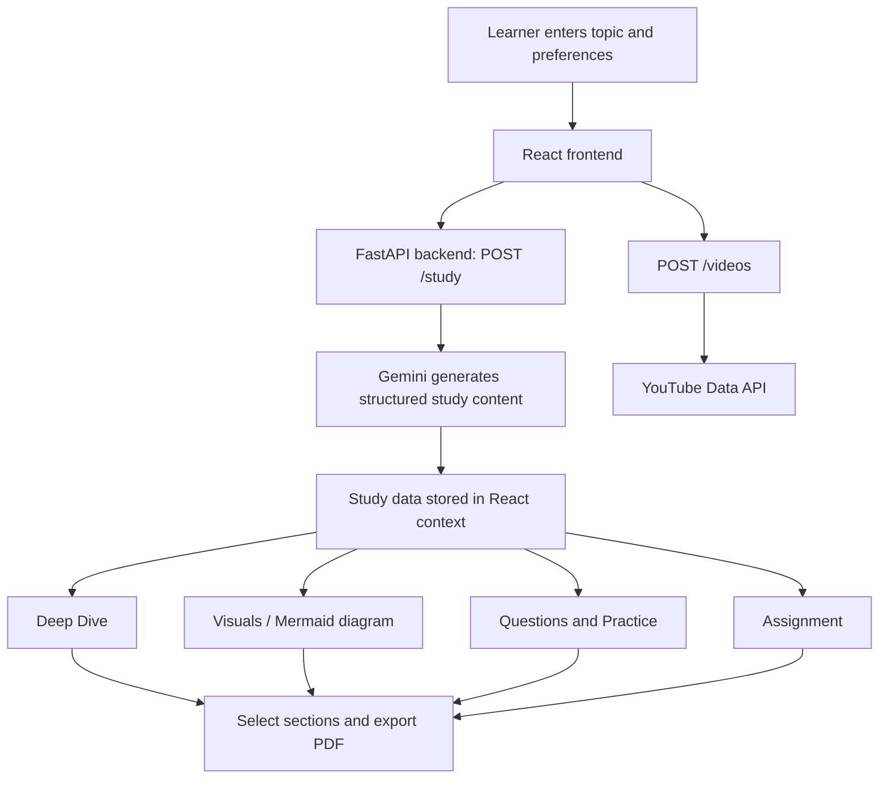

# GEdu Learner — AI Study Companion

GEdu Learner is a web-based AI study companion that helps learners create a topic-focused study packet. A learner enters a topic, subject/domain, education level, and preferred language; the application requests generated learning content from a Python backend and presents it through a guided study workflow.

## Contents

- [Features](#features)
- [How It Works](#how-it-works)
- [Technology Stack](#technology-stack)
- [Project Structure](#project-structure)
- [Prerequisites](#prerequisites)
- [Configuration and API Keys](#configuration-and-api-keys)
- [Installation](#installation)
- [Running the Application](#running-the-application)
- [API Reference](#api-reference)
- [Study Workflow](#study-workflow)
- [PDF Export](#pdf-export)
- [Troubleshooting](#troubleshooting)
- [Security Notes](#security-notes)
- [Limitations and Future Improvements](#limitations-and-future-improvements)
- [Contributing](#contributing)
- [License](#license)

## Features

### Personalized study-plan generation
- Enter a topic and domain/field.
- Choose an education level:
  - High School (9th–10th)
  - High School (11th–12th)
  - Undergraduate (College)
  - Postgraduate (Masters/PhD)
  - Professional / Research
- Select a supported language: English, Hindi, Spanish, or French.
- Request structured study content from the backend.

### Guided learning sections
The frontend provides a sequence of learning pages:

- **Deep Dive:** topic summary, key points, formulas, and a control to request more detail.
- **Visuals:** a Mermaid diagram representing the topic.
- **Tutorials:** YouTube lecture search results returned by the backend.
- **Questions:** intended for flashcards or important questions.
- **Practice:** generated practice problems with an option to load more.
- **Assignment:** generated tasks with checkboxes and an option to add more tasks.
- **Download PDF:** choose which study sections to include and export a study packet.

### Additional learning content
The backend's `/more` endpoint can request additional deep-dive text, question data, practice problems, or assignment tasks.

### Mathematical notation and responsive diagrams
- `react-latex-next` is used to render LaTeX-style content in learning pages.
- Mermaid.js renders generated diagram code as an SVG in the browser.
- Bootstrap provides layout and UI components.

## How It Works

1. The learner opens the home page and enters a topic, domain, education level, and language.
2. The React app sends a `POST /study` request to the FastAPI backend.
3. The backend asks Google's Gemini model to return a JSON study plan.
4. The frontend stores the response in shared React context.
5. The learner navigates between the study sections.
6. The Tutorials page requests long-form YouTube videos through `POST /videos`.
7. The learner can request more content through `POST /more`.
8. The Download page assembles selected sections and generates a PDF in the browser.



## Technology Stack

### Frontend
- React
- React Router DOM
- Bootstrap
- Mermaid.js
- `react-latex-next`
- KaTeX styles
- `html2pdf.js`

### Backend
- Python
- FastAPI
- Pydantic
- Google Generative AI Python SDK (`google-generativeai`)
- Google API Python Client (`google-api-python-client`)
- Uvicorn (recommended ASGI development server)

### External services
- Google Gemini API for study content generation
- YouTube Data API for tutorial/lecture search

## Project Structure

The following reflects the supplied files and the imports visible in them. Your complete project may contain additional files.

```text
project-root/
├── main.py                  # FastAPI application and API endpoints
├── agents.py                # Alternative/mock agent helpers and YouTube search
├── test_models.py           # Lists available Gemini models (utility script)
├── package.json             # Expected frontend manifest; not included in supplied files
├── requirements.txt         # Recommended Python dependency list; not included
├── public/
│   └── logo.png             # Referenced by the UI; ensure this file exists
└── src/
    ├── index.js              # React entry point
    ├── App.js                # Routes and provider setup
    ├── Navbar.js             # Navigation
    ├── StudyContext.js       # Shared study state
    ├── Mermaid.js            # Mermaid diagram rendering
    └── pages/
        ├── Home.js
        ├── DeepDive.js
        ├── DiagramPage.js
        ├── VideosPage.js     # Imported by App.js; not included in supplied files
        ├── QuestionsPage.js  # Imported by App.js; not included in supplied files
        ├── PracticePage.js
        ├── AssignmentPage.js
        └── DownloadPage.js
```

**Note:** Some supplied files may have been uploaded from different revisions. For example, `App.js` imports `QuestionsPage.js` and `VideosPage.js`, but those page files were not among the uploads. `agents.py` also contains a mock LLM helper and a different YouTube search approach; the primary API implementation described here is based on `main.py`.

## Prerequisites

Install the following before running the project:

- Python 3.10 or newer (recommended; verify compatibility with your installed libraries).
- Node.js and npm.
- A Google Gemini API key.
- A YouTube Data API key with YouTube Data API v3 enabled.
- Internet access for API-backed generation and video search.

## Configuration and API Keys

The backend uses two external credentials:
- `GEMINI_API_KEY` for Gemini content generation.
- `YOUTUBE_API_KEY` for YouTube lecture search.


## Installation

### 1. Get the project files

Place the backend files in a backend directory and the React application files in the appropriate frontend source structure. The imports in `App.js` expect page components under `src/pages/`.

### 2. Set up the Python backend

From the backend/project root, create and activate a virtual environment.

**Windows PowerShell**
```powershell
python -m venv .venv
.\.venv\Scripts\Activate.ps1
```

**macOS / Linux**
```bash
python3 -m venv .venv
source .venv/bin/activate
```

Install the core backend dependencies:

```bash
pip install fastapi uvicorn google-generativeai google-api-python-client pydantic
```

If you plan to use the alternative helper in `agents.py`, also install:

```bash
pip install youtube-search-python
```

You can save a reproducible environment after verifying the application works:

```bash
pip freeze > requirements.txt
```

### 3. Set up the React frontend

The supplied files do not include `package.json`. In the existing React app, install the dependencies used by the provided source:

```bash
npm install react react-dom react-router-dom bootstrap mermaid react-latex-next katex html2pdf.js
```

If you are creating a new frontend project, scaffold a React app using your preferred tooling, then place the supplied components in the corresponding `src/` and `src/pages/` directories. Ensure `App.css` exists because `index.js` imports it, and ensure the logo is available at `public/logo.png` or change the image path.

## Running the Application

### Start the backend

With the virtual environment active and the API keys configured:

```bash
uvicorn main:app --reload --host 127.0.0.1 --port 8000
```

The API should then be available at `http://127.0.0.1:8000`.

FastAPI's interactive API documentation is typically available at:
- Swagger UI: `http://127.0.0.1:8000/docs`
- ReDoc: `http://127.0.0.1:8000/redoc`

### Start the frontend

From the frontend directory, run the script supported by its `package.json`, commonly:

```bash
npm start
```

Some React setups use:

```bash
npm run dev
```

Open the local development URL shown in the terminal. The supplied frontend currently calls the backend using `http://localhost:8000`.

> **CORS note:** `main.py` currently allows all origins (`*`) and all methods/headers. This is convenient for local development but should be restricted to the actual frontend origin before production deployment. If cookies or credentials are used, configure CORS deliberately rather than combining wildcard origins with credentials.

## API Reference

All endpoints are implemented in `main.py` and accept JSON requests.

### `POST /study`

Generates the initial study packet using Gemini.

**Request body**
```json
{
  "topic": "Newton's Laws of Motion",
  "domain": "Physics",
  "level": "Undergraduate (College)",
  "language": "English"
}
```

**Expected response shape**
```json
{
  "deep_dive": {
    "summary": "A detailed summary of the topic.",
    "key_points": ["Key concept 1", "Key concept 2"],
    "formulas": ["Formula 1", "Formula 2"]
  },
  "flashcards": [
    {"q": "Question 1?", "a": "Answer 1"},
    {"q": "Question 2?", "a": "Answer 2"}
  ],
  "practice": [
    {"question": "Practice problem 1"},
    {"question": "Practice problem 2"}
  ],
  "assignment": {
    "title": "Homework Title",
    "tasks": ["Task 1", "Task 2"]
  },
  "diagram": "graph TD; A(\"Node\") --> B(\"Text\")"
}
```

The frontend also attaches the selected `topic`, `domain`, and `level` to the returned data before storing it in shared state.

**Implementation note:** The backend's prompt asks Gemini for the structure above and then parses the model output as JSON. If generation fails or the returned text is not valid JSON, the endpoint returns an object with an `error` field.

### `POST /more`

Requests additional content for a given topic.

**Request body**
```json
{
  "topic": "Newton's Laws of Motion",
  "current_context": "Existing summary text",
  "type": "deep_dive"
}
```

Supported `type` values in the current implementation:

| `type` | Intended result |
|---|---|
| `deep_dive` | Additional explanatory text in `new_content` |
| `questions` | New question/answer data in `new_data` |
| `practice` | Additional practice problems in `new_data` |
| `assignment` | Additional assignment tasks in `new_data` |

The endpoint returns JSON. The exact shape depends on the requested type; see the prompts in `main.py`. On exception, the current implementation returns a generic error object with empty `new_data`.

### `POST /videos`

Searches YouTube for longer videos related to the requested topic, domain, and level.

**Request body**
```json
{
  "topic": "Newton's Laws of Motion",
  "domain": "Physics",
  "level": "Undergraduate (College)"
}
```

**Response shape**
```json
{
  "videos": [
    {
      "title": "Example lecture title",
      "videoId": "VIDEO_ID",
      "channel": "Example channel",
      "description": "Video description"
    }
  ]
}
```

The search query includes the topic, domain, lecture/course terms, and level. The endpoint requests up to six relevant video results and filters for long-duration videos. On failure, it returns an empty `videos` list and an error message.

## Study Workflow

The home form sends the selected study preferences to `/study`. After a successful response, the app stores the result in `StudyContext`, and the navigation links become available when study data exists.

The intended page sequence is:

1. Home — choose the topic and preferences.
2. Deep Dive — read the summary, key points, and formulas.
3. Visuals — inspect the generated Mermaid concept map.
4. Tutorials — browse YouTube lectures.
5. Questions — review question/answer content.
6. Practice — work through generated problems.
7. Assignment — review and check off tasks.
8. Download PDF — export selected content.

The app keeps the current study data and video results in React context. The current implementation uses in-memory React state, so refreshing the browser may clear the active study packet.

## PDF Export

The Download page uses `html2pdf.js` to generate a PDF in the browser. The user can select whether to include:

- Deep Dive
- Diagram
- Flashcards / important questions
- Practice problems
- Assignment tasks

The generated file is named using the topic, followed by `_StudyPacket.pdf`. The current PDF configuration uses letter-size portrait pages and a small margin.

## Troubleshooting

### Backend connection failed
- Confirm the FastAPI server is running on port `8000`.
- Confirm the frontend's API URL matches the backend host and port.
- Inspect the browser developer console and backend terminal for errors.

### Gemini generation fails
- Check that the Gemini API key is valid and enabled.
- Confirm the installed SDK supports the model name configured in `main.py`.
- Check quota, billing, network access, and the backend's printed error.
- Ensure the response is valid JSON; the backend currently expects JSON-only output.

### YouTube results are empty
- Verify the YouTube Data API key and API access.
- Check quota limits and API errors.
- Try a more specific topic/domain combination.

### Mermaid diagram does not render
- The diagram must be valid Mermaid syntax.
- The UI strips backticks and the word `mermaid` before rendering.
- If the generated syntax is invalid, the component displays a warning.

### PDF export is incomplete or poorly formatted
- Check which sections are selected.
- Ensure the page content is fully rendered before export.
- Test long diagrams and content across page breaks; complex SVGs may need additional PDF styling.

### Frontend build errors
- Confirm every imported page component exists, especially `QuestionsPage.js` and `VideosPage.js`.
- Confirm `App.css` and `public/logo.png` exist, or update the imports/paths.
- Install all packages imported by the project.


## Contributing

Contributions are welcome. A useful contribution workflow is:

1. Create a branch for your change.
2. Keep secrets out of source control.
3. Make the change and add tests where appropriate.
4. Run the frontend and backend locally.
5. Update this README if setup steps, endpoints, or features change.
6. Open a pull request with a concise description of the change.
